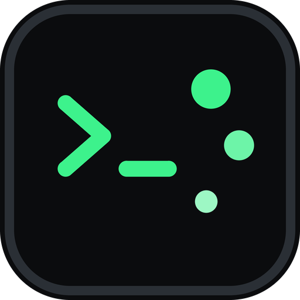

<p align="center"></p>

# Swarmux

A real Windows terminal for running many coding agents side by side. Tabs, split panes, session restore and alerts when a pane finishes. Light, fast and open source.

## Features

- Real terminals through Windows ConPTY: PowerShell 7, Windows PowerShell, Command Prompt, WSL and Git Bash, with colours, vim, htop and full-screen apps.
- A profile menu like Windows Terminal: every shell and WSL distribution with `Ctrl+Shift+1…9`, Settings (`Ctrl+,`) and a command palette (`Ctrl+Shift+P`).
- Opens with Windows (on by default, switch it off in Settings), and saves your session on shutdown, sleep and lock, so a restart brings everything back.
- Tabs and split panes; drag a divider to resize, double-click it to even it out.
- Each pane shows its state: working (amber), finished (green), bell (red), ended (hollow). When a pane goes quiet after working and you are looking elsewhere, you get a Windows notification and the taskbar flashes.
- Broadcast mode types into every pane of a tab at once.
- Picks up where you left off: tabs, splits, shells, folders and recent output come back on the next start.
- GPU rendering, 20,000 lines of scrollback per pane, and output batched every 8 ms, so long sessions stay smooth.

## Install

Download `Swarmux-Setup.exe` from the [latest release](https://github.com/chsxthwik/SWARMUX/releases/latest) and run it. You choose the folder; no admin rights needed. The installer is not code-signed yet, so if SmartScreen asks, choose **More info**, then **Run anyway**.

## Run from source

Needs Windows 10 or 11 and Node.js 20 or newer.

```powershell
git clone https://github.com/chsxthwik/SWARMUX
cd SWARMUX
npm install
npm start
```

Build the installer with `npm run dist`; it lands in `dist/`.

## Shortcuts

| Keys | Action |
| --- | --- |
| `Ctrl+Shift+T` | New tab |
| `Ctrl+Shift+D` / `Ctrl+Shift+E` | Split right / down |
| `Ctrl+Shift+W` | Close pane |
| `Alt+Arrows` | Move between panes |
| `Ctrl+Tab`, `Ctrl+1…9` | Switch tabs |
| `Ctrl+Shift+Z` | Zoom pane |
| `Ctrl+Shift+B` | Broadcast to all panes in the tab |
| `Ctrl+Shift+F` | Find |
| `Ctrl+C` (with selection), `Ctrl+V`, right-click | Copy and paste |
| `Ctrl+=`, `Ctrl+-`, `Ctrl+0` | Font size |
| `F2` | Rename tab |
| `Ctrl+Shift+1…9` | New tab with a profile |
| `Ctrl+Shift+P` | Command palette |
| `Ctrl+,` | Settings |
| `F1` | All shortcuts |

## License

MIT, by QUANTUM.
